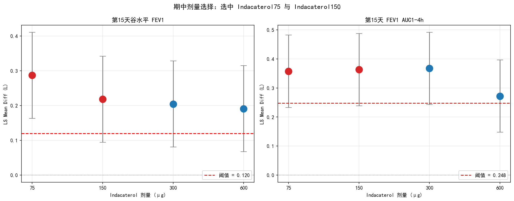
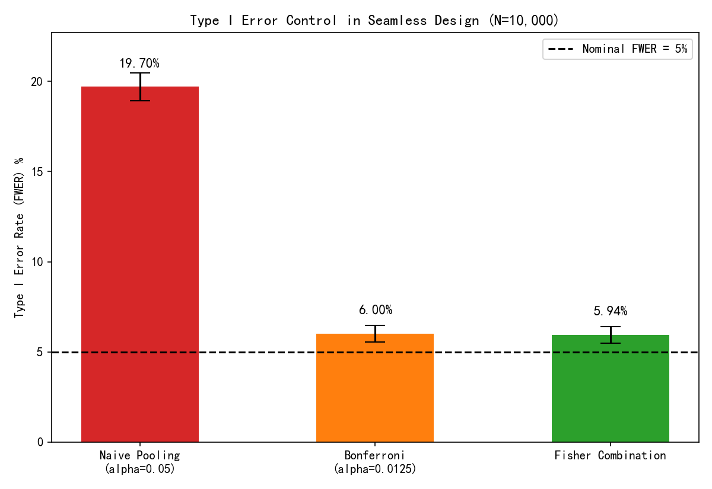

# INHANCE: Adaptive Seamless Trial Simulation

Python replication of the INHANCE Phase II/III adaptive seamless dose-selection trial in COPD.

## Overview

This project reproduces the complete statistical workflow of the INHANCE trial — a real Phase II/III adaptive seamless design used to select doses of indacaterol for COPD treatment. The implementation covers:

- Stratified block randomization and baseline simulation
- Interim analysis with ANCOVA and automated dose selection
- Sample size and power estimation
- **Seamless inference and multiplicity control (FWER simulation)**
- **Operating Characteristics (OC) simulation under realistic dose-response**

## Project Structure

    inhance-trial-simulation/
    ├── src/                        # Reusable Python modules
    │   ├── config.py               # Global parameters & reference drugs
    │   ├── randomization.py        # Stratified block randomization
    │   ├── simulate.py             # Baseline and endpoint simulations
    │   ├── analysis.py             # ANCOVA and threshold computation
    │   ├── dose_selection.py       # 8-rule dose selection logic
    │   └── sample_size.py          # Sample size and power functions
    ├── tests/                      # Unit tests (pytest)
    │   └── test_randomization.py
    ├── 01_randomization.ipynb
    ├── 02_endpoints.ipynb
    ├── 03_interim_analysis.ipynb
    ├── 04_sample_size.ipynb
    ├── 05_seamless_inference.ipynb # FWER simulation
    ├── 06_final_oc_and_fwer.ipynb  # Advanced 10k OC simulation
    ├── dose_selection.png
    ├── fwer_simulation.png
    ├── fwer_simulation_advanced.png
    ├── requirements.txt
    ├── LICENSE
    └── .gitignore

## Key Figure

*Interim dose selection based on ANCOVA-adjusted LS Mean differences. Red dots indicate selected doses; the dashed red line marks the selection threshold.*

## Methods

### 1. Randomization & Baseline
- Stratified block randomization (smoking status; block length 7 or 14).
- Parametric baseline simulation with group-mean correction.
- Balance assessment via ANOVA, chi-square, and SMD.

### 2. Interim Analysis
- ANCOVA with baseline FEV1/FVC and smoking status as covariates.
- LS Mean difference vs Placebo with 95% CI.
- Automated 8-rule dose selection algorithm.

### 3. Seamless Inference & Multiplicity Control

To demonstrate the necessity of multiplicity adjustment in adaptive seamless designs, we simulated 10,000 trials under the null hypothesis (involving 2 endpoints × 2 selected doses = 4 comparisons). 

As shown in the figure below:
- **Naive Pooling** (directly merging stages without adjustment) causes the Family-Wise Error Rate (FWER) to inflate severely to **19.70%**.
- **Bonferroni correction** (α/4 = 0.0125) brings the FWER down, but the observed rate (**6.00%**) still slightly exceeds the nominal 5% level.
- **Fisher's Combination Test** approaches the nominal level (**5.94%**), though not perfectly strict.

*Note: Error bars represent the 95% Monte Carlo confidence intervals based on 10,000 simulations.*

**Methodological Insight (Winner's Curse):**
The fact that Bonferroni fails to strictly control the FWER at 5% reveals a critical property of seamless designs: **Selection-induced bias (Winner's Curse)**. Because the doses are selected based on their inflated Stage-1 observed means, naive data pooling corrupts the Type I error. **Bonferroni correction alone is insufficient** because it only addresses multiplicity, not selection bias. Proper control requires stagewise combination tests (like Fisher's) or closed testing procedures that account for the selection mechanism. This simulation serves as a cautionary demonstration of why naive pooling should be avoided in adaptive designs.

### 4. Operating Characteristics (OC) Simulation

To evaluate the operating characteristics under a realistic dose-response relationship (effects of 50, 80, 110, and 140 mL for the four doses), we simulated 500 seamless trials. 

- **Correct Selection Rate at Interim:** 83.6% (reflects the uncertainty of selecting the true maximum dose due to sampling noise at N=120/group).
- **Overall Power (Success Rate):** 96.8% (with Bonferroni adjustment α/4 = 0.0125).

*Note: The analytical sample size calculation (N=518/group) does not account for the variance reduction from ANCOVA baseline adjustment. In practice, adjusting for FEV1/FVC yields a variance deflation factor, potentially reducing the required sample size. This simulation evaluates operating characteristics based on the unadjusted SD (270 mL) for a conservative estimation.*

## Quick Start

    git clone https://github.com/zhengjunhong0311/inhance-trial-simulation.git
    cd inhance-trial-simulation
    pip install -r requirements.txt
    jupyter lab

All results are reproducible with fixed random seed (1128).

## References

- Donohue JF, et al. Once-daily bronchodilators for chronic obstructive pulmonary disease: indacaterol versus tiotropium. *Am J Respir Crit Care Med*. 2010;182(2):155-62.
- Barnes PJ, et al. Integrating indacaterol dose selection in a clinical study in COPD using an adaptive seamless design. *Stat Methods Med Res*. 2010;23(3):165-71.

## License

MIT
